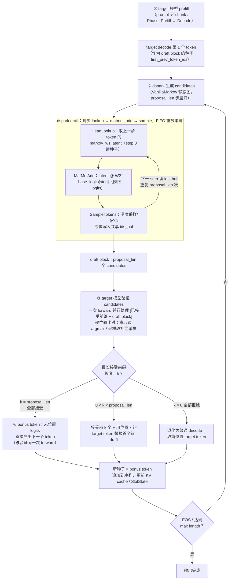

# DSpark Decode 状态

> 整体 decode 流程的验证结论与流程图（对照 `src/dspark/qwen3/markov_head.rs`、
> `src/operators/softmax/sample_tokens.rs` 与 DeepSpec `VanillaMarkov` 语义）。

## 流程验证结论

四步骨架（target prefill + 首 token → dspark 出 candidates → target 验证 → 循环）整体正确，
但有两点需要精确化：

1. **验证与 bonus token 是同一次前向**。target 对 `[已接受前缀 + draft block]` 做一次并行
   forward，逐位置比对得到接受长度；最后一个被接受位置的 logits 直接给出下一个 token
   （bonus token），无需额外的单 token decode。只有首轮 prefill 之后那次 decode 产出的
   第一个 token 充当 draft block 的种子（`first_prev_token_ids`）。
2. **dspark 不是独立 draft 模型**，而是半自回归 draft：并行主干产出的 base logits
   （每步一个 `[batch, vocab]`）由轻量 Markov head 逐步修正——step k 以上一步 draft
   token 查 `markov_w1`，`latent @ W2ᵀ + base_logits[k]` 后采样写入共享 `ids_buf`，
   step k+1 读取该值继续采样，链式展开 `proposal_len` 步得到整个 draft block。

## 流程图

## 当前实现状态

| 环节 | 状态 | 位置 |
|------|------|------|
| ① prefill → 首 token | ✅ 已实现 | `scheduler.rs`（Phase::Prefill → Decode）、`sample_tokens.rs` |
| ② dspark draft block 静态图 | ✅ 已实现（仅 Vanilla 变体，图构建级测试通过） | `src/dspark/qwen3/markov_head.rs::sample_block_tokens` |
| draft 执行接入 decode 循环 | ⚠️ 未接线（`test_vanilla_markov_execute_f32` 标 `#[ignore]`） | 同上 |
| ③ target 验证（accept/reject） | ⚠️ 未实现，仅预留字段 | `SampleTokens` 的 `proposal_len` / `proposal_index` |
| ④ 循环回到 draft | ⚠️ 未实现（`Phase` 无 Verify 阶段） | `runtime/session.rs` |
